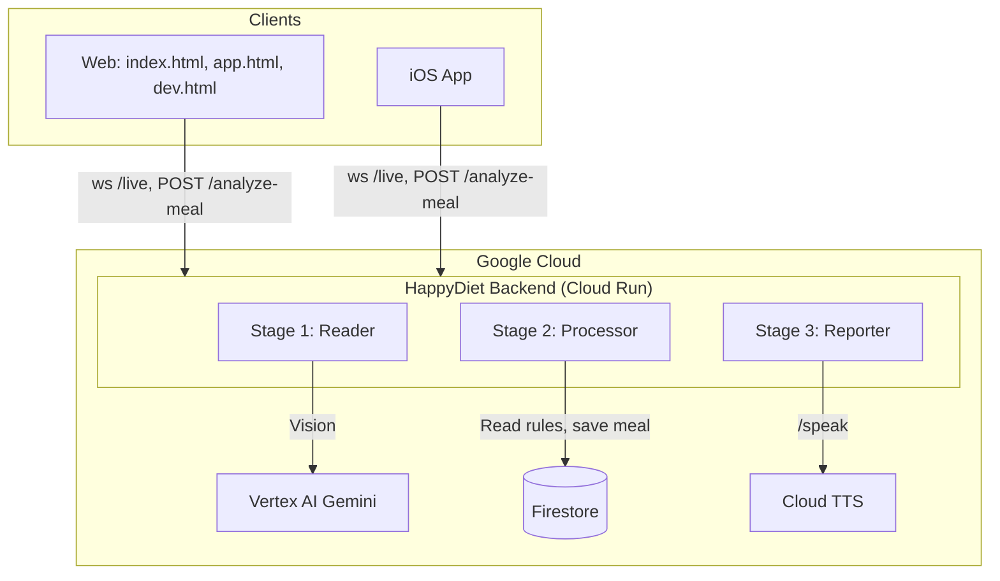

# HappyDiet — Architecture Diagram

**For judges:** Clear visual representation of the system. See [Gemini Live Agent Challenge](https://geminiliveagentchallenge.devpost.com).

**Features:** See [features.md](./features.md). **Current state:** See [stack-architecture.md § Where We Stand](./stack-architecture.md#where-we-stand-current-state).

---

## Client Matrix

| Client | Capture | Live API | HTTP REST | Platform |
|--------|---------|----------|-----------|----------|
| **Web Showcase** (`/` or `index.html`) | Camera, upload | ✅ WebSocket to `/live` | — | Browser (any device) |
| **Web App** (`/app.html`) | Camera, upload | — | ✅ | Browser |
| **Dev Playground** (`/dev.html`) | Camera, upload | — | ✅ | Browser |
| **iOS App** | Camera, Photo Library, **HeyCyan** | ✅ Live Coach tab | ✅ | Native iOS only |

**HeyCyan glasses:** Require **native iOS** (BLE + WiFi). Web browsers cannot access BLE on iOS Safari. See [heycyan-integration.md](./heycyan-integration.md).

---

## System Architecture

```
┌─────────────────────────────────────────────────────────────────────────────────────────┐
│  CLIENTS                                                                                 │
│  ┌─────────────────────┐  ┌─────────────────────┐  ┌─────────────────────────────────┐ │
│  │ Web (index.html)    │  │ Web (app.html,       │  │ iOS App                         │ │
│  │ • Live API (ws)     │  │      dev.html)       │  │ • Live Coach (Live API)         │ │
│  │ • Voice + image     │  │ • Camera, upload     │  │ • Camera, Photo Library, HeyCyan │ │
│  │ • Chat, Speak       │  │ • Analyze, Diet,     │  │ • Analyze, Diet, Dashboard      │ │
│  └──────────┬──────────┘  │      Dashboard       │  └────────────────┬────────────────┘ │
│             │             └──────────┬────────────┘                   │                  │
└─────────────┼──────────────────────┼────────────────────────────────┼──────────────────┘
              │                      │                                │
              │ ws://host/live       │ HTTPS (REST)                   │ ws + HTTPS
              │                      │ POST /analyze-meal             │
              │                      │ POST /parse-diet               │
              │                      │ GET /meals, GET /rules         │
              └──────────────────────┼────────────────────────────────┘
                                    ▼
┌─────────────────────────────────────────────────────────────────────────────────────────┐
│  HappyDiet Backend (Cloud Run) — Tool for Live Agent                                      │
│  ┌─────────────────────────────────────────────────────────────────────────────────────┐│
│  │  Stage 1 (Reader)    →  Stage 2 (Processor)  →  Stage 3 (Reporter)                    ││
│  │  Image → Vision      →  Rule matching        →  Message + persist                     ││
│  │  ingredients, kcal      compliance score        JSON → client / Live API              ││
│  └─────────────────────────────────────────────────────────────────────────────────────┘│
└────────────────────────────────────────┬────────────────────────────────────────────────┘
                                         │
              ┌──────────────────────────┼──────────────────────────┐
              ▼                          ▼                          ▼
┌─────────────────────┐  ┌─────────────────────┐  ┌─────────────────────────────────────┐
│  Vertex AI (Gemini)  │  │  Cloud TTS          │  │  Firestore                          │
│  • gemini-2.5-flash  │  │  • /speak → MP3     │  │  • meals (userId, ingredients, score) │
│  • Vision            │  │  • Voice output     │  │  • diet_rules (allowances, limits)  │
│  • Parse-diet        │  │                     │  │                                      │
│  • Semantic match    │  │                     │  │                                      │
└─────────────────────┘  └─────────────────────┘  └─────────────────────────────────────┘
```

---

## Flow A: HTTP REST (Analyze, Diet, Dashboard)

```
Client (Web or iOS) → POST /analyze-meal (image_base64, user_id)
                    → Backend: Reader → Processor → Reporter
                    → JSON (score, items, message)
                    → Optional: POST /speak for TTS
```

---

## Flow B: Live API (Voice + Vision, Barge-in)

```
Client (Web index.html or iOS Live Coach) → ws://backend/live (WebSocket)
                                         → Backend proxy (format translation: audio → media_chunks, camelCase → snake_case)
                                         → Vertex AI Live API
                                         → User speaks / sends image
                                         → Tool call: analyze_meal → Backend
                                         → Backend returns JSON
                                         → Live API speaks to user (barge-in supported)
```

**Proxy:** Translates client formats to Vertex wire format. See [stack-architecture.md § Proxy Format Translation](./stack-architecture.md#proxy-format-translation).

---

## Mermaid Diagram (for README / docs)



---

## Data Flow (Meal Analysis)

1. **User** captures meal photo (camera, upload, or HeyCyan on iOS).
2. **Client** sends image (base64) via `POST /analyze-meal` or Live API tool call.
3. **Reader** calls Vertex AI Vision → ingredients, estimatedKcal.
4. **Processor** loads rules from Firestore, matches ingredients → compliance score; saves meal to Firestore.
5. **Reporter** builds message (text for TTS or Live API).
6. **Backend** returns JSON (score, items, message).
7. **Client** displays result; TTS or Live API speaks it.

**Implementation:** See [agents.md](./agents.md) for how Reader, Processor, Reporter are defined and run (files, orchestration, entry points).

---

## GCP Services

| Service | Purpose |
|---------|---------|
| **Cloud Run** | Hosts Node.js backend (REST + Live API proxy) |
| **Vertex AI** | Gemini: Vision, parse-diet, semantic compliance, Live API |
| **Firestore** | `meals`, `diet_rules` collections |
| **Cloud TTS** | Text-to-speech for `/speak` endpoint |
