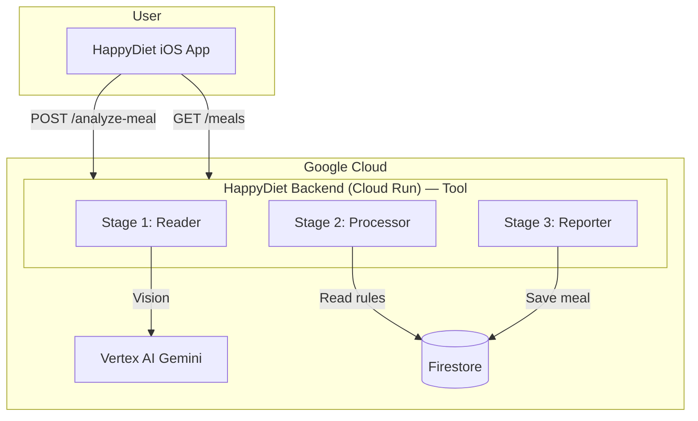

# HappyDiet — Architecture Diagram

**For judges:** Clear visual representation of the system. See [Gemini Live Agent Challenge](https://geminiliveagentchallenge.devpost.com).

**Features:** See [features.md](./features.md). **Current state:** See [stack-architecture.md § Where We Stand](./stack-architecture.md#where-we-stand-current-state).

---

## System Architecture

```
┌─────────────────────────────────────────────────────────────────────────────────┐
│  USER (iPhone)                                                                   │
│  • Opens HappyDiet app                                                           │
│  • Captures meal photo (camera or library)                                       │
│  • Sees compliance result + hears voice (TTS or Live API)                       │
│  • Views dashboard (meal history, scores)                                        │
└────────────────────────────────────────┬────────────────────────────────────────┘
                                         │
                    ┌────────────────────┴────────────────────┐
                    │                                         │
                    ▼                                         ▼
┌───────────────────────────────┐         ┌───────────────────────────────────────┐
│  FLOW A: Direct (current)     │         │  FLOW B: Live Agent (target)          │
│  iOS → Backend (HTTP)         │         │  iOS → Gemini Live API (WebSocket)     │
│  POST /analyze-meal           │         │  → tool call → Backend → JSON         │
│  GET /meals                   │         │  → Live API speaks to user            │
└───────────────────────────────┘         └───────────────────────────────────────┘
                    │                                         │
                    └────────────────────┬────────────────────┘
                                         │
                                         ▼
┌─────────────────────────────────────────────────────────────────────────────────┐
│  HappyDiet Backend (Cloud Run) — Tool for Live Agent                             │
│  • Stage 1 (Reader): Image → Vertex AI Vision → ingredients, kcal                │
│  • Stage 2 (Processor): Rules matching → compliance score                        │
│  • Stage 3 (Reporter): Build message → JSON                                      │
└────────────────────────────────────────┬────────────────────────────────────────┘
                                         │
                    ┌────────────────────┴────────────────────┐
                    │                                         │
                    ▼                                         ▼
┌───────────────────────────────┐         ┌───────────────────────────────────────┐
│  Vertex AI (Gemini)           │         │  Firestore                            │
│  • gemini-2.5-flash           │         │  • meals (userId, ingredients, score)  │
│  • Vision, parse-diet, semantic│         │  • diet_rules (allowances, limits)     │
└───────────────────────────────┘         └───────────────────────────────────────┘
```

---

## Mermaid Diagram (for README / docs)



---

## Data Flow

1. **User** captures meal photo in iOS app
2. **iOS** sends image (base64) to Backend `POST /analyze-meal`
3. **Reader** calls Vertex AI Vision → ingredients, kcal
4. **Processor** loads rules from Firestore, matches ingredients → compliance
5. **Reporter** builds message, saves meal to Firestore
6. **Backend** returns JSON (score, items, message) to iOS
7. **iOS** displays result; TTS or Live API speaks it

---

## GCP Services

| Service | Purpose |
|---------|---------|
| **Cloud Run** | Hosts Node.js backend |
| **Vertex AI** | Gemini model for meal image analysis |
| **Firestore** | Meals and diet rules persistence |
